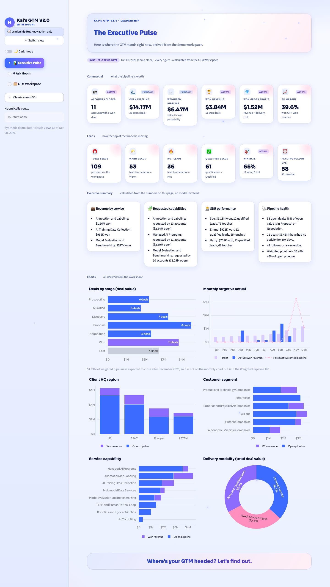
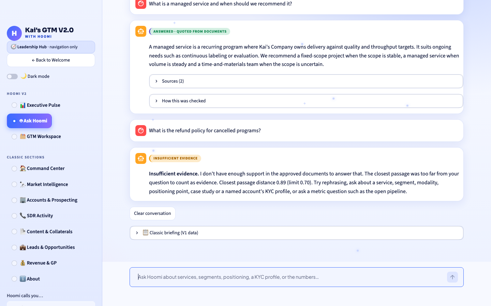
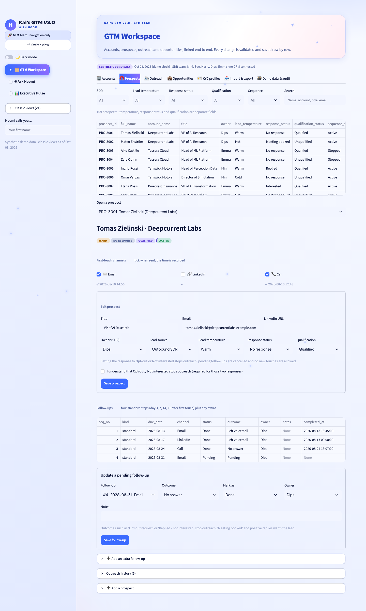

# Kai's GTM V2.0, with Hoomi

A local, polished prototype of a GTM command centre for **Kai's Company** (an AI data services business; the name "Kai's Company" is used for this project). It has an **Executive Pulse**, a linked **GTM Workspace** (accounts, prospects, outreach, opportunities), and **Hoomi**, a grounded assistant that answers from approved documents with citations, calculates the numbers from the workspace, and says plainly when it doesn't have enough evidence.

The **workspace data** (accounts, contacts, opportunities, KYC profiles) is **synthetic demo data**, stored locally. The **document knowledge base** is seven Markdown documents (capabilities, three ICPs, three case studies) that are **sanitized and derived from real company materials**: client and company names, people, branding and contact details are removed, and operational figures (volumes, counts, durations) are deliberately generalised. There is **no CRM integration and no authentication**. The app makes **no hosted AI call unless you choose Fireworks and approve it** for the session.



## Run it

Requires **Python 3.12**.

```bash
python3.12 -m venv .venv312
source .venv312/bin/activate
pip install -r requirements.txt
streamlit run app.py          # opens http://localhost:8501
```

**First run.** The demo workspace (`data/gtm_v2.db`) is created and seeded automatically. Hoomi's document search needs the small public embedding model (BAAI/bge-small-en-v1.5, about 67 MB). It is never downloaded implicitly. Fetch it once, deliberately:

```bash
python -m rag.app_index --allow-model-download      # one-time; builds the knowledge index too
```

After that everything runs offline. Building the index takes about a minute the first time; later, editing a KYC profile re-embeds only that account's few passages. Without the model the app still works: metric questions and the classic rule-based Hoomi stay available, and Ask Hoomi says document search is unavailable.

Deep links skip the Welcome screen (navigation only): `?view=leadership&page=pulse`, `?view=team&page=workspace`, `?view=leadership&page=hoomi`.

## What's in it

| Area | What you get |
|---|---|
| **Welcome** | Hoomi's greeting, an optional on-device voice (a button; uses only local browser voices, never an online voice), and the **Leadership Hub / GTM Team** choice. The choice is navigation only, not a login. |
| **Executive Pulse** | Commercial KPIs (Accounts Closed, Open and Weighted Pipeline, Won Revenue, Won Gross Profit, GP Margin), lead KPIs (Total, Warm, Hot, Qualified, Win Rate, Pending Follow-ups), a plain-language summary (revenue by service, requested capabilities, SDR performance, pipeline health) and six charts (stage, monthly target vs actual, client HQ region, customer segment, service capability, modality). Every number comes from `gtm/pulse.py`; the commercial KPIs are checked against V1's independent `metrics.py`. |
| **GTM Workspace** | Linked **Accounts, Prospects, Outreach Activities, Opportunities** for the SDRs Mini, Sue, Harry, Dips and Emma. Lead temperature, response status and opportunity stage are separate fields, as are customer segment and modality. Email / LinkedIn / Call checkboxes with timestamps; four standard follow-ups (day 3, 7, 14, 21) plus extras, each with date, channel, outcome, notes and owner; **opt-out, rejection and closure stop outreach** (opt-out is permanent). KYC profiles with a completeness score and a **blank template download**. Row-level writes, validation, deduplication and an audit log. |
| **Ask Hoomi** | A chat with a pinned input, history, sources with verbatim quotes, per-fact checks and an explicit **insufficient evidence** answer. A small floating Hoomi at the bottom-right of every other page opens it. Metric questions are *calculated*; document questions are answered by the **offline extractive demo engine** (zero hosted calls); a question naming an account searches only that account's KYC profile. Fireworks answers are opt-in and need your approval (see below). The classic rule-based Hoomi is kept (a tab, an explicit mode, and the fallback when document search is unavailable). |
| **Classic views (V1)** | All original pages (Command Center, Market Intelligence, Accounts, SDR Activity, Content, Leads & Opportunities, Revenue & GP, About) with their original filters, kept under *Classic views* in the sidebar. |




## How Hoomi answers

1. **Numbers** (`gtm/numbers_qa.py`): pipeline, revenue, win rate, follow-ups, top SDR and so on are calculated from the workspace, so they always match the Pulse. They are never retrieved or generated.
2. **Documents** (`rag/`): local retrieval (FastEmbed vectors in a Chroma index) behind an **answerability gate**, then the **offline extractive engine** quotes the closest sentences with citations. It cannot reason or paraphrase. If nothing is close enough, you get "insufficient evidence", and that answer is final: it is never rescued by looser keyword rules.
3. **Fireworks natural-language answers** (`rag/providers.py`, `rag/verify.py`): choose *Fireworks* in Ask Hoomi's answer style. It stays **off by default** and does nothing until (a) `LLM_MODEL` and `FIREWORKS_API_KEY` are in your own `.env` (copy `.env.example`) **and** (b) you tick the on-page approval box for the session. Then document questions are answered in natural language by the generate-then-verify pipeline: per-fact verification, fail-closed on malformed output, citations only from chunks whose quote was found. If the hosted step fails or cannot be verified you get the labelled offline answer instead. Its automated tests use mocks only; the project owner has also run it live successfully. The command-line check is `python -m rag.smoke --help`.

## Data and privacy

* **Two separate local stores**, both git-ignored: the V2 workspace `data/gtm_v2.db` (Pulse, Workspace, Ask Hoomi) and the V1 store `data/kai_gtm.db` (classic views). They start from the same synthetic records and are edited independently; V1 browsing never writes the V1 database.
* The V2 seed maps the V1 CSVs through an explicit import mapping (`gtm/seed.py`); every original column is kept in each row's `orig_json`.
* The demo clock is fixed at **8 Oct 2026** so figures are reproducible (`GTM_CLOCK=real` uses the real date).
* **No** real prospect, contact or KYC data is included, and nothing is sent anywhere unless you approve a Fireworks call. The original source decks are not in this repository. `.env`, vector indexes, model caches and databases are git-ignored.
* CSV exports neutralise spreadsheet formulas; CSV import is a local file with row and size limits, a preview, and the store's own validation and deduplication. The display name you can type is sanitised before it reaches HTML or script.

## Tests

```bash
pip install -r requirements.txt
python -m pytest test_calculations.py test_gtm.py test_rag.py test_eval.py test_providers.py test_verify.py test_smoke.py \
       test_gtm_store.py test_gtm_pulse.py test_gtm_import_qa.py test_rag_app.py test_chat.py test_theme.py test_pack.py test_app_ui.py -q
```

About 430 tests, all offline (the UI tests drive the real `app.py` headlessly with Streamlit's AppTest, with sockets blocked and counted). Retrieval quality is measured separately: see `eval/report.md` (15 questions), `eval/validation_report.md` (10 held-out questions) and their honest limits. In short, ranking is decent, but a distance threshold alone cannot separate every unanswerable question from an answerable one.

## Layout

```
app.py                  Welcome gate, navigation, routing         views/   pages (welcome, pulse, workspace_gtm, hoomi_page, mascot, V1 views)
gtm/                    V2 store, schema, seed, validation, KYC, pulse, import, numbers Q&A, demo clock
rag/                    ingest, retriever, app_index, offline engine, chat, hosted pipeline (providers, verify), evaluation, smoke
rag_corpus/             the seven approved Kai's Company .md files   rag_corpus_legacy/   the earlier synthetic corpus (test fixtures only)
eval/                   questions, results and reports            static/hoomi3d/     the 3D Hoomi component (Three.js, vendored)
theme.py                blue / white / midnight with pink and lavender, light and dark
```

## Not done / honest limits

* **Mascot:** Hoomi is a 3D robotic cat built from primitives with Three.js (`static/hoomi3d/`, served by Streamlit static serving, no network). The fur is stylized shells, not simulated hair. It needs WebGL; without it a plain text fallback still opens Ask Hoomi. The retired 2D "Pixel" artwork is kept only in `assets/hoomi_pixel_backup/`.
* **Offline demo engine** quotes sentences; it cannot compose or reason. The Fireworks pipeline that can is opt-in. Its automated tests use mock models only; live Fireworks runs by the project owner (including a two-part question) succeeded, but no live-model evaluation set has been scored.
* **Gate and similarity thresholds are provisional** and tuned on small hand-written question sets; hard negatives that reuse the corpus's vocabulary can still pass the gate.
* **Voice** is a click-to-play greeting (Play and Mute) that uses only a recognised feminine on-device voice and is disabled if none exists; there is no voice input.
* No authentication, multi-user concurrency control, CRM, Apollo/ZoomInfo connection (only a local CSV import), or deployment. No demo video was recorded.
* The V1 floating panel still uses Streamlit's deprecated `components.html`; it works in the pinned Streamlit 1.66.0.


## Final-submission additions (V2.0)

* **Knowledge pack:** `rag_corpus/` holds the seven approved Markdown documents (capabilities, three ICPs, three case studies). The earlier synthetic corpus is in `rag_corpus_legacy/` and is used only as a test fixture. Rebuild the local index with `python -m rag.app_index` (local FastEmbed, no download once the model is cached). The documents were sanitized for publication: operational figures from the source case studies were generalised, and no client identities appear. Do not add the original decks or any unsanitized material to this repository.
* **Evaluation:** `python -m rag.pack_eval` runs 20 direct, cross-document and unanswerable questions (`eval/pack_report.md`). The offline engine is measured for real; the Fireworks pipeline only against mock models. Live Fireworks tests were run separately by the project owner.
* **Browser smoke test:** with the app running, `python browser_smoke.py` (needs `pip install playwright` and Google Chrome) checks the 3D cat renders, follows the pointer and blinks, that clicking it opens Ask Hoomi, that all seven sources are listed and that every sidebar section opens.
* **Launch:** `HF_HUB_OFFLINE=1 .venv312/bin/python -m streamlit run app.py`
