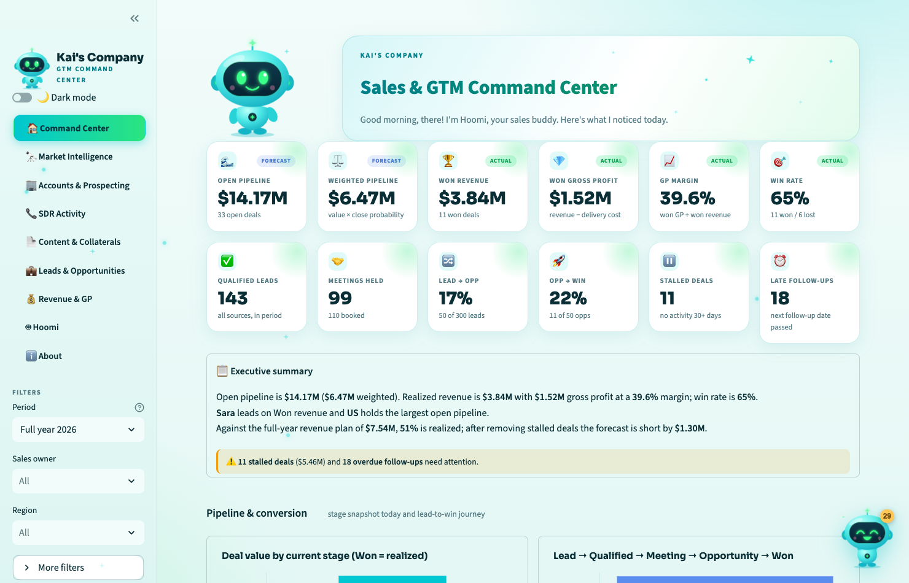

# Kai's Company — Sales & GTM Command Center

A premium, playful, AI-native internal GTM product for **Kai's Company**, a *fictional* AI and data consulting business. Eight connected modules, one friendly companion (**Hoomi**), light and dark themes, and entirely **fictional** demo data. Built with Python, Streamlit, Pandas, Plotly and SQLite. No API keys, no paid services, no real company data.



## Setup and run

**Requirements:** Python 3.9 or newer (developed on 3.9.6, macOS). No API keys, accounts, database server or paid services are needed.

```bash
# 1. Get the code
git clone https://github.com/YOUR-USERNAME/YOUR-REPO-NAME.git
cd YOUR-REPO-NAME

# 2. Create a private Python environment (one time)
python3 -m venv .venv

# 3. Switch it on (do this in every new terminal)
source .venv/bin/activate            # Windows: .venv\Scripts\activate

# 4. Install the libraries (one time)
pip install -r requirements.txt

# 5. Launch the app - your browser opens at http://localhost:8501
streamlit run app.py
```

Stop the app with `Ctrl + C`.

- **First launch:** the app creates a local SQLite file (`data/kai_gtm.db`) from the CSV files in `data/`. That file is git-ignored; delete it, or use *About → Reset demo data*, to start fresh.
- **Run the automated checks:** `pip install pytest && pytest -q` (30 tests).
- **Port already in use?** `streamlit run app.py --server.port 8502`

## The eight modules

| # | Module | What you can do |
|---|---|---|
| 1 | **Command Center** | 12 KPI cards, funnels, trends, targets vs actuals, performance by rep/region/segment/service with click-to-drill, stalled deals and late follow-ups |
| 2 | **Market Intelligence** | Market research, prospecting-**tool** research (Apollo, ZoomInfo, LinkedIn…) kept separate from per-**account** research |
| 3 | **Accounts & Prospecting** | 64 accounts, ICP scores, personas, 109 contacts, an "Account 360" view linking everything |
| 4 | **SDR Activity** | Calls, emails, LinkedIn, follow-ups, responses, qualified leads, meetings; leaderboard; targets vs actuals; weekly/daily trends |
| 5 | **Content & Collaterals** | Decks, case studies, proposals, campaigns, RFPs: owners, approvals, workload, overdue tracking |
| 6 | **Leads & Opportunities** | Searchable tables, deal aging, won/lost reasons, **edit mode** saved to SQLite |
| 7 | **Revenue & GP** | Targets vs realized vs weighted forecast, GP margin, forecast-gap waterfall, win/loss analysis |
| 8 | **Hoomi** | Floating, draggable assistant on every page + a full Hoomi page |

Plus an **About** page with technical notes, definitions and the AI-agent roadmap.

### Using it
- **Sidebar:** navigation, dark-mode toggle, and global filters (period, owner, region, and *More filters*: segment, service, stage). Every chart, table, KPI and Hoomi answer follows them.
- **Click a bar** in the Command Center "Performance & drilldown" chart to see the deals behind it.
- **Edit deals:** Leads & Opportunities → toggle *Edit mode* → change stage / probability / dates / next action → *Save changes*. Reset any time on the About page.
- **Hoomi:** click the floating mascot (bottom-right). Drag it anywhere; it remembers its spot. First visit shows a welcome animation.

## Financial definitions (used everywhere)

- **Open pipeline** = deal value of open deals — *forecast*
- **Weighted pipeline / forecast** = deal value × close probability — *forecast*
- **Realized revenue & GP** = **Won deals only** — *actual*. Open pipeline is never counted as realized.
- **Gross profit** = revenue − delivery cost; **GP margin** = GP ÷ revenue
- **Win rate** = Won ÷ (Won + Lost) · **Lead→Opp** = opportunities ÷ leads · **Opp→Win** = Won ÷ opportunities
- **Stalled** = open deal with no activity for 30+ days · **Late follow-up** = next follow-up date has passed
- **Risk-adjusted gap** = FY target − realized − (weighted forecast − stalled weighted value)
- **Period filter:** open deals are a live snapshot; Won/Lost, leads and SDR activity follow the dates
- "Today" in the fictional dataset is fixed at **8 Oct 2026**

## Project structure

```
app.py               navigation, filters, theme toggle            views/        one file per module
theme.py             colours, light/dark, sparkles, KPI cards     db.py         SQLite persistence
workspace.py         loads data + applies global filters          data/         fictional CSV seed data
metrics.py           pipeline maths (from Version 1)              docs/         screenshots
analytics.py         leads, SDR, collateral, revenue/GP, gaps     hoomi.py             mascot SVG + rule-based brain
hoomi_widget.py      floating draggable assistant
generate_data.py + generate_gtm_data.py   re-create the fictional data
```

## About Hoomi
Hoomi v1 runs **local Python calculations** and **transparent rule-based answers** on the fictional data. It is not an LLM or autonomous agent (see *About* inside the app). All brain logic sits behind one function, `answer_with_mood()` in `hoomi.py`, so Claude, LangChain or n8n can be connected later without touching the UI.

## Fictional data and disclaimer
- This is a **learning project** (Maven Agentic AI course, Week 1). Kai's Company is invented. All company names, people, `example.com` email addresses, deal values, ratings and activity numbers are **fictional, generated by the scripts in this repo**. No real, confidential or client data is used anywhere.
- Any resemblance of an invented name to a real organization is coincidental.
- Names such as Apollo, ZoomInfo, LinkedIn or Crunchbase appear only as *examples of prospecting tools* on the Market Intelligence page. The "ratings" and "findings" next to them are made up for the demo and are not reviews or endorsements.
- The page loads two fonts from Google Fonts when online (it falls back to system fonts offline). Nothing else is fetched and no data leaves your computer.

## Notes
- Everything is fictional: company names, people, `example.com` emails, numbers, tool "ratings".
- Re-create data: `python generate_data.py && python generate_gtm_data.py` (then delete `data/kai_gtm.db`).
- Accessibility: animations switch off automatically for people who prefer reduced motion.
